<!-- cool-readme:start -->
<!-- Cards by github-cool-readme: https://github.com/pedrocatalao/github-cool-readme -->

<picture>
  <source media="(prefers-color-scheme: dark)" srcset="https://raw.githubusercontent.com/MelvinGGS/MelvinGGS/cards/summary-dark.svg">
  
</picture>
<picture>
  <source media="(prefers-color-scheme: dark)" srcset="https://raw.githubusercontent.com/MelvinGGS/MelvinGGS/cards/languages-dark.svg">
  
</picture>

<picture>
  <source media="(prefers-color-scheme: dark)" srcset="https://raw.githubusercontent.com/MelvinGGS/MelvinGGS/cards/contributions-dark.svg">
  
</picture>
<picture>
  <source media="(prefers-color-scheme: dark)" srcset="https://raw.githubusercontent.com/MelvinGGS/MelvinGGS/cards/weekly-dark.svg">
  
</picture>

<picture>
  <source media="(prefers-color-scheme: dark)" srcset="https://raw.githubusercontent.com/MelvinGGS/MelvinGGS/cards/streaks-dark.svg">
  
</picture>
<picture>
  <source media="(prefers-color-scheme: dark)" srcset="https://raw.githubusercontent.com/MelvinGGS/MelvinGGS/cards/about-dark.svg">
  
</picture>

<!-- cool-readme:end -->

  <picture>
    <source media="(prefers-color-scheme: dark)" srcset="https://skillicons.dev/icons?i=c,rust,go,linux,kubernetes,docker,gcp,rabbitmq,githubactions,nodejs,react,ts,js,python,java,cs,postgres,redis&perline=9&theme=dark">
    <source media="(prefers-color-scheme: light)" srcset="https://skillicons.dev/icons?i=c,rust,go,linux,kubernetes,docker,gcp,rabbitmq,githubactions,nodejs,react,ts,js,python,java,cs,postgres,redis&perline=9&theme=light">
    
  </picture>

  <picture>
    <source media="(prefers-color-scheme: dark)" srcset="https://raw.githubusercontent.com/MelvinGGS/MelvinGGS/output/galaga-contribution-graph-dark.svg">
    <source media="(prefers-color-scheme: light)" srcset="https://raw.githubusercontent.com/MelvinGGS/MelvinGGS/output/galaga-contribution-graph.svg">
    
  </picture>

  
  
  
  

